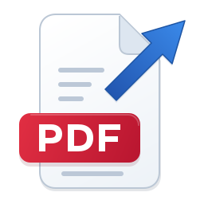
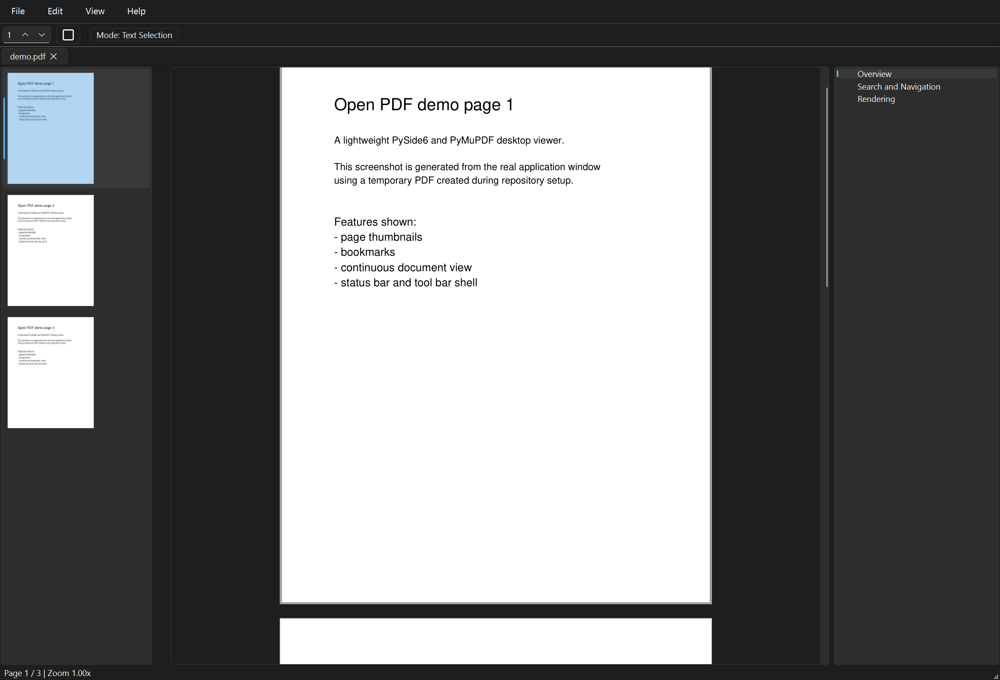

<!-- Authoring guidance: dev-docs/specs/README_SPEC.instructions.md -->
<!-- rumdl-disable MD033 MD041 -->

  

<h1 align="center">Open PDF</h1>

  A lightweight desktop PDF viewer with light editing, for people who want to
  read, search, and touch up PDFs without a heavyweight suite.

<!-- rumdl-enable MD033 MD041 -->

---

## About

Open PDF is a no-frills desktop reader for PDF files on Windows and Linux. Open
a document from your file manager or the command line and start reading right
away: pages render as you reach them instead of waiting for the whole file.
Light editing is there when you need it, such as redacting a region, replacing a
line of text, reordering pages, and saving the result back over the original.
The Windows portable build runs from a USB stick and keeps its settings beside
itself.

The [Linux implementation](platform/linux/README.md) uses Qt desktop controls,
XDG storage, and the desktop keyring. Its GitHub Actions build targets Ubuntu
24.04 x86-64; the first hosted build and Linux runtime verification are pending.

The initial [macOS implementation](platform/mac_os/README.md) adds Finder file
opening, native menus, Keychain storage, and app-bundle tooling. Its Python
tests pass on Windows; the first native Mac build and runtime checks are
pending.

## Features

- Open several PDFs at once in tabs you can drag to reorder; launching again
  forwards the file to the running window
- Read in continuous scrolling or single-page view, and navigate with page
  jumps, thumbnails, bookmarks, and links inside the PDF
- Zoom to actual size, fit width, fit page, or with `Ctrl` + mouse wheel
- Search the whole document as you type and copy selectable text
- Redact a page region or replace the text it covers
- Insert blank pages, reorder, rotate, or delete pages, and edit bookmarks
- Edit document metadata and keep plain-text notes stored inside the PDF
- Run optional Tesseract OCR on one page or the whole document
- Save in place, save a copy, rename the file, or print all or part of it
- Remember passwords for encrypted PDFs using Windows protection or Linux's
  Secret Service desktop keyring

## App Screenshot

## User Manual

See the [User Manual](docs/USER_MANUAL.md) for installation, setup, usage, and
troubleshooting.

## License

Open PDF's original code is licensed under the [MIT License](LICENSE).

Third-party dependencies retain their own licenses. In particular,
[PyMuPDF and MuPDF](https://pymupdf.readthedocs.io/en/latest/about.html#license-and-copyright)
are offered under AGPL or a commercial license. This repository's MIT license
does not replace those terms; distributing Open PDF with these dependencies
requires compliance with their applicable licenses.
